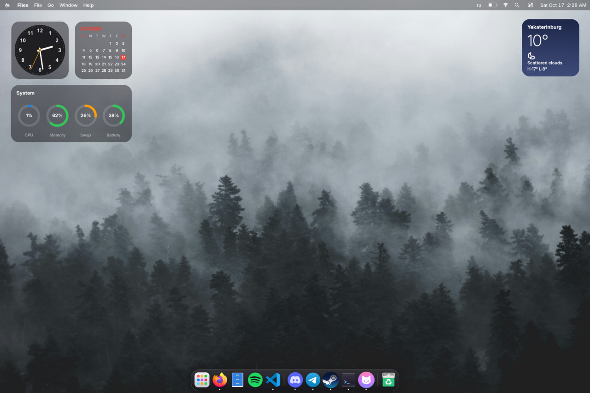
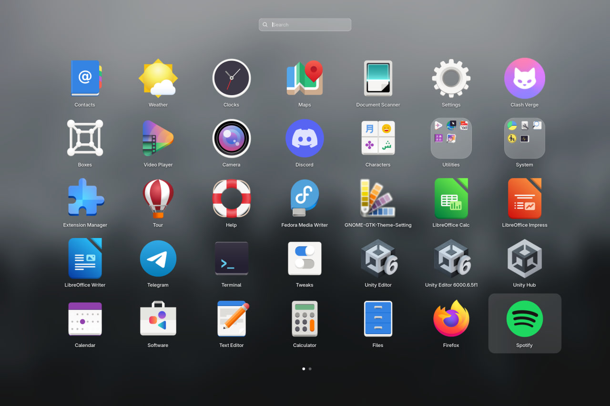
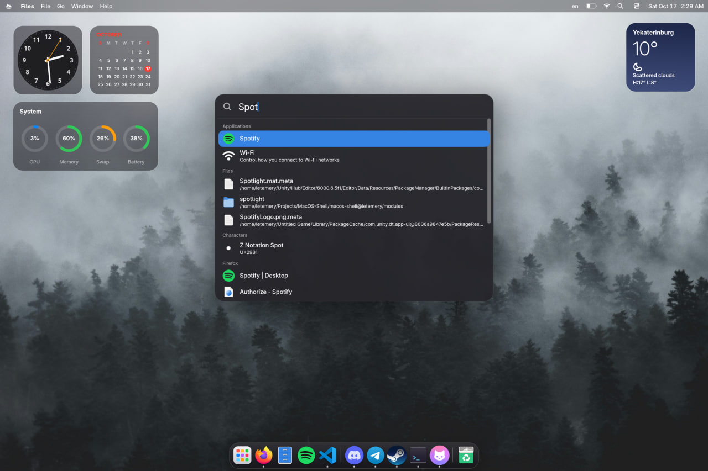
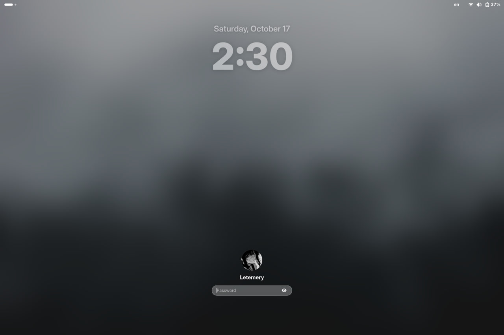

# MacOS Shell для GNOME Shell

<p align="center">
  
</p>

Расширение GNOME Shell, которое делает рабочий стол похожим на macOS Tahoe. Оно состоит
из модулей: каждый включается и выключается отдельно и настраивается на своей странице
в параметрах расширения. Интерфейс переведён на русский и английский, язык
переключается на лету.

*English version below.*

## Скриншоты

<table>
  <tr>
    <td align="center"><b>Launchpad</b></td>
    <td align="center"><b>Spotlight</b></td>
  </tr>
  <tr>
    <td></td>
    <td></td>
  </tr>
  <tr>
    <td align="center"><b>Экран блокировки</b></td>
    <td align="center"><b>Поиск курсора встряхиванием</b></td>
  </tr>
  <tr>
    <td></td>
    <td></td>
  </tr>
</table>

## Возможности

### Основные модули

| Модуль | Что делает |
|---|---|
| **Строка меню** | Слева меню с логотипом, жирное название приложения и меню **Файл, Правка, Вид, Окно, Справка** (на рабочем столе — **Переход** с папками, как у Finder). Справа батарея, Wi‑Fi, Spotlight, **Пункт управления** и часы. Полупрозрачная, прозрачная или сплошная |
| **Док** | Всегда на экране, иконки увеличиваются под курсором и подпрыгивают при запуске. Точки запущенных приложений, подсказки, меню, корзина. Развёрнутые окна заканчиваются над доком |
| **Виджеты** | Часы, календарь, дата, погода, монитор системы с батареей, широкий виджет батарей всех устройств. Лежат на рабочем столе под окнами, перетаскиваются мышью |
| **Уведомления** | Стеклянные баннеры, выезжающие из угла экрана, и стеклянный центр уведомлений |
| **Экран блокировки** | Крупные дата и время сверху, аватарка и поле пароля снизу, размытие обоев при вводе пароля, анимация разблокировки как в macOS |
| **Spotlight** | Поиск приложений, файлов, настроек и всего, что ищет обзор GNOME. Калькулятор и поиск в интернете. **Super+F** или лупа в строке меню |

### Дополнительные

| Модуль | Что делает |
|---|---|
| **Launchpad** | Полноэкранная сетка приложений на размытых обоях вместо сетки GNOME: поиск, страницы с точками, папки GNOME, управление с клавиатуры. Открывается кнопкой «Приложения» в доке, клавишей **Super** и **Super+A** |
| **Громкость и яркость** | Окошко как в macOS Tahoe при нажатии клавиш: стеклянная панель под строкой меню с заголовком и широким ползунком |
| **Кнопки окон** | «Закрыть», «свернуть», «развернуть» слева; красная, жёлтая и зелёная, значки при наведении |
| **Анимация сворачивания** | Окно уходит в свою иконку в доке эффектом «Джинн» или «Масштаб» и так же возвращается |
| **Системные окна** | Запрос пароля администратора, пароль Wi‑Fi, выключение, «Приложение не отвечает», запросы разрешений в стиле macOS: иконка сверху, кнопки-капсулы, основная синяя |
| **Поиск курсора** | Если быстро поводить мышью влево-вправо, курсор увеличивается и потом возвращается к обычному размеру |

## Установка

Требования: GNOME Shell 48–50 (проверено на GNOME Shell 50, Fedora 44) и
`glib-compile-schemas`.

```bash
./install.sh               # установить или обновить и включить
./install.sh --no-enable   # установить, не включая
./install.sh --uninstall   # удалить (настройки сохраняются)
./install.sh --pack        # собрать zip в ./dist
```

После установки на Wayland нужно **выйти из сеанса и войти снова**.

Готовый архив ставится так:

```bash
gnome-extensions install --force dist/macos-shell@letemery.shell-extension.zip
```

Прошлые версии расширения (`macos-shell@macos-shell`, `macos-tahoe@macos-shell` и отдельные
`tahoe-*@macos-shell`) установщик удаляет сам и переносит их настройки.

## Настройки

```bash
gnome-extensions prefs macos-shell@letemery
```

На главной странице два списка модулей — основные и «Дополнительные». У каждого есть
переключатель, а по щелчку открываются его параметры. Ниже выбираются язык и оттенок
стекла (как в системе, светлый, тёмный).

Сбросить все настройки:

```bash
dconf reset -f /org/gnome/shell/extensions/macos-shell/
```

## Подробности и ограничения

**Строка меню.** Пункты «Правка» и «Вид» работают в любом приложении: они отправляют окну
стандартные сочетания клавиш (Ctrl+C, Ctrl+Z, Ctrl++…) по кодам клавиш, поэтому работают
и в русской раскладке. Цветные точки у Пункта управления показывают, что используются
микрофон, камера, запись экрана или геолокация. Логотип можно заменить своей картинкой.
Если установлено Just Perfection, пока модуль включён, в его настройках выставляются «часы
справа» и «без Обзора», а при выключении возвращаются прежние значения.

**Spotlight.** Стрелки выбирают результат, Enter открывает, Esc очищает строку или
закрывает окно. Выражение вроде `(2+3)*4^2` считается сразу, Enter копирует ответ.
Сочетание можно сменить на Ctrl+Alt+Пробел, Super+Alt+Пробел или Super+Пробел
(в GNOME Super+Пробел переключает раскладку).

**Виджеты и погода.** Виджеты лежат на рабочем столе под окнами или, по выбору, поверх них.
Погода берётся из libgweather; город выбирается в настройках виджетов, а если не выбран —
используется город из «Погоды» GNOME или текущее местоположение.

**Launchpad.** Порядок иконок как в сетке GNOME, остальное по алфавиту. Страницы листаются
колесом, свайпом, PageUp/PageDown и точками внизу; стрелки и Enter выбирают и открывают,
Esc закрывает папку, очищает поиск и закрывает Launchpad. Правый щелчок — «Добавить
в Dock». Если Super нужен для обзора GNOME, это выключается в настройках модуля; обзор
в любом случае открывается горячим углом и жестом тремя пальцами.

**Кнопки окон.** Порядок кнопок задаётся через `org.gnome.desktop.wm.preferences
button-layout`, прежнее значение возвращается при выключении. Цвета записываются блоком
в `~/.config/gtk-3.0/gtk.css` и `~/.config/gtk-4.0/gtk.css` и удаляются при выключении;
`gtk.css`, принадлежащий теме (символическая ссылка или файл, который уже рисует эти
кнопки, как WhiteSur), не трогается. Видно в приложениях, открытых после изменения.
Не затрагиваются приложения со своими заголовками (Discord, Spotify, Telegram) и
Flatpak-приложения без доступа к этим папкам:

```bash
flatpak override --user --filesystem=xdg-config/gtk-3.0:ro --filesystem=xdg-config/gtk-4.0:ro
```

**Анимация сворачивания.** Пока модуль включён, он заменяет анимацию GNOME. Без дока окно
уходит вниз по центру экрана.

**Системные окна.** Меняются только окна, которые рисует GNOME Shell. Окна внутри
приложений («Сохранить изменения?», выбор файла), пароль `sudo` в терминале и экран входа
в систему не затрагиваются.

**Поиск курсора.** Увеличенный курсор рисует расширение, системный на это время
скрывается. На некоторых видеокартах mutter 50 не прячет аппаратный курсор, и маленький
курсор остаётся виден поверх большого.

## Структура

```
macos-shell@letemery/
  extension.js        включает и выключает модули
  prefs.js            окно настроек
  lib/                переводы, общий контекст, помощники для настроек
  modules/<имя>/      module.js, prefs.js и stylesheet.css модуля
  icons/              значки строки меню, дока и курсора
  po/                 переводы (ru.po и шаблон)
  schemas/            настройки GSettings
install.sh            установка, удаление, сборка zip
tools/update-po.sh    обновление переводов
tools/headless-test/  проверка в изолированном GNOME Shell
docs/                 скриншоты и GIF для README
```

## Проверка

```bash
tools/headless-test/run.sh
```

Скрипт запускает расширение в отдельном GNOME Shell без экрана (свой D-Bus, свой dconf,
ваш сеанс не затрагивается), проверяет модули и сохраняет результаты и скриншоты
в `test-output/`.

## Переводы

Перевод лежит в `macos-shell@letemery/po/ru.po`. После изменения строк в коде:

```bash
tools/update-po.sh
```

---

## English

<p align="center">
  
</p>

A GNOME Shell extension that makes the desktop look like macOS Tahoe. It is made of
modules that you switch on or off and configure in the extension's preferences. The UI
is in English and Russian.

**Modules:** menu bar (logo menu, app name, File/Edit/View/Window/Help, status icons,
clock), magnifying dock, desktop widgets (clock, calendar, weather, system, batteries),
notification banners, lock screen and Spotlight (Super+F).

**Additional:** Launchpad (dock's Applications button, Super, Super+A), volume and
brightness pop-ups, red/yellow/green title bar buttons on the left, the genie minimize
animation, macOS-style system dialogs (password, power off, "not responding") and
shake to find the cursor.

```bash
./install.sh               # install or update and enable
./install.sh --uninstall   # remove (settings are kept)
./install.sh --pack        # build a zip in ./dist
gnome-extensions prefs macos-shell@letemery
tools/headless-test/run.sh # test in an isolated headless GNOME Shell
```

Version 1.0. Requires GNOME Shell 48–50. On Wayland, log out and back in after installing.
